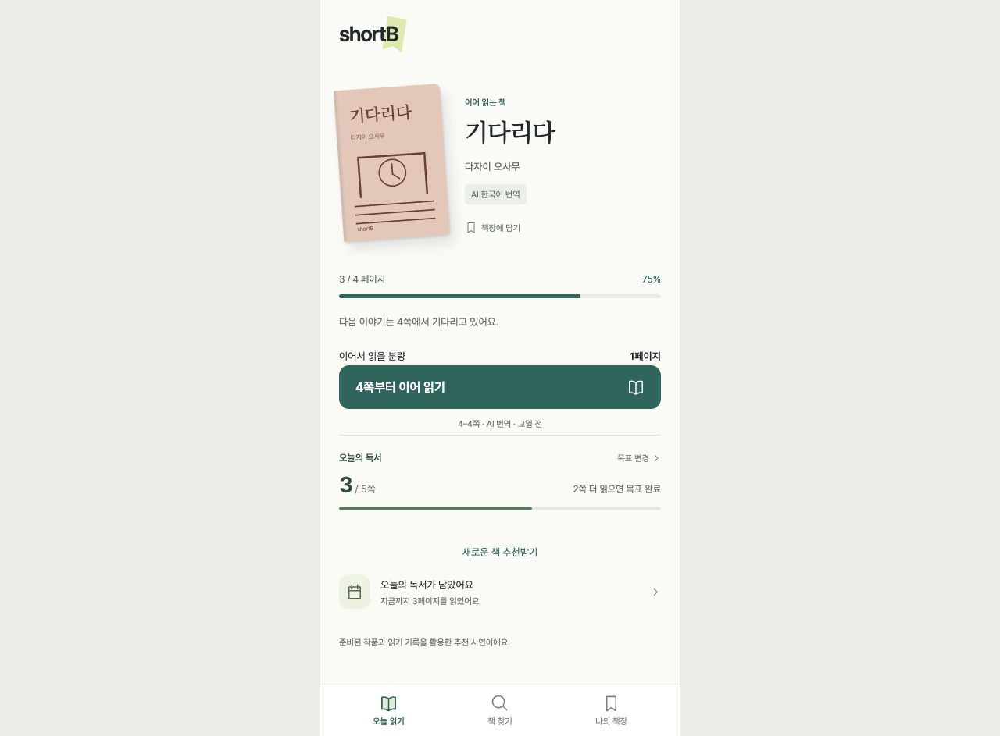

# shortB 프론트엔드 디자인 시안

모바일 중심의 고전 독서 서비스입니다. **화면 분리 기준은 사용자가 수행하는 기능과 화면 전환 흐름**입니다.

## 실행

1. **[HTML 시안 ZIP](shortB-html.zip)**을 다운로드해 압축을 풉니다.
2. 압축을 푼 `shortB-html` 폴더에서 아래 명령으로 실행합니다.
3. 개발 소스는 **[React 소스 ZIP](shortB-react-source.zip)**에 있습니다. 압축을 풀고 `npm ci`, `npm run dev`로 시작합니다.




```sh
python3 -m http.server 8875 --bind 127.0.0.1
```

- 전체 화면: http://127.0.0.1:8875/pages.html
- 실제 첫 방문 흐름: http://127.0.0.1:8875/index.html
- VS Code Live Server로 열어도 됩니다. `assets` 폴더를 HTML과 함께 유지해주세요.

## 화면을 나눈 기준

| 분류 | 파일 | 목적 |
| --- | --- | --- |
| 진입·독서 | index, trial, trial-done, home, book, reader, complete, discover | 첫 체험 → 책 선택 → 읽기 → 완료 → 대비 추천 |
| 추천·탐색 | setup, preferences, search | 생활/목표/취향 설정, 취향 변경, 가나다순 검색 |
| 기록 | library, calendar, highlights, goals | 책장, 날짜별 독서, 형광펜, 하루 목표 |
| 계정 | login, signup, email, code, signup-password, recover, recover-sent | 로그인 및 회원가입 흐름 시안 |
| 기타 | settings, source, about | 설정, 판본/출처, 앱 안내 |

총 **25개 화면 + 목록용 pages.html**입니다. 위 파일명에 `.html`을 붙이면 됩니다.
책마다 별도 HTML을 만드는 방식이 아니라 `book.html?book=waiting`처럼 동일 화면에 책 데이터를 넣습니다.
추천 설정의 3단계는 하나의 `setup.html`에서 상태를 바꾸며 진행합니다.
공통 CSS, JavaScript, 글꼴은 `assets/`에 모았습니다.
HTML에는 React에서 생성한 초기 화면이 들어 있고, 공통 React 번들이 화면 전환과 상태를 이어받습니다.

## 이번 수정

- 상단 프로필과 목표 배지 제거
- 오늘 목표를 읽기 버튼 아래에 배치: 읽은 쪽수, 남은 목표, 진행선, 목표 변경
- 정확한 이어읽기, 같은 책의 중복 표시 방지, 가나다순 검색
- 독서 목표, 형광펜, 대비 추천, 첫 독서 이후 가입/추천 설정
- 발표용 독서 달력은 10월 15일 표시·최근 6일 연속 예시이며 실제 목표/책장 기록과 분리

## 시연 범위

백엔드, 실제 로그인/메일 인증, AI 추천 API는 미연결입니다. 계정 화면은 흐름 확인용이며 이메일/비밀번호를 저장하지 않습니다. 인증번호 시안은 `123456`입니다.
독서·취향 데이터는 브라우저 로컬 저장소에 남습니다. 정적 서버 주소가 바뀌면 브라우저 저장 영역도 달라집니다.
한국어 원문 2편과 공개 원문에서 새로 번역한 AI 한국어 전문 5편을 포함합니다. AI 번역은 전문 번역가 교열 전이며 출처 화면에서 표시합니다. 다른 4편은 번역 중으로 본문 읽기가 열려 있지 않습니다.
독서 완료 화면은 실제로 읽기 분량을 완료하면 내용이 채워집니다.

검증: TypeScript 및 빌드 통과, 독서/복원/중복/추천 순환/형광펜/저장 실패 등 14개 테스트 통과. 브라우저에서 읽기 → 완료 → 이어읽기, 목표 변경을 확인했습니다.
